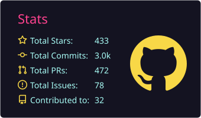
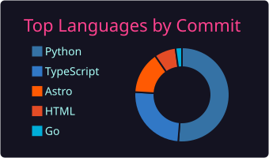

<!-- 顶部 Banner：固定粉→紫渐变 + 白字 + 副标题（原 color=auto 每次刷新随机换色，与整体主题不符） -->

# 🌸 Hi there, I'm Sallyn (sallyn0225) 🌸

  
  

---

### 💫 About Me
- 🔭 **Current Focus**: **Vibe Coding**. I build things by empowering myself with AI agents.
- 🤖 **Workflow**: Using multiple AI agents that cross-collaborate to ensure code robustness and quality.
- 🎨 **Interests**: BanG Dream!, iDOLM@STER, Vocaloid, travel, music.

---

### 🚀 Featured Projects
> **[eidolon-sc](https://github.com/Sallyn0225/eidolon-sc)**
> *AI companions of all 28 IdolMaster Shiny Colors idols you can text or call in real time — they reply in Japanese voice with Chinese subtitles, recall their in-game stories, and share memories with each other. Built with FastAPI + Pipecat (WebRTC) + Next.js, one-command Docker Compose deploy.*

> **[Gemini RSS Translator](https://github.com/Sallyn0225/gemini-rss-app)**
> *An intelligent RSS aggregator that uses Gemini AI to translate and summarize news, specifically optimized for multimedia and seiyuu fans.*

> **[shinycolors-song-guess](https://github.com/Sallyn0225/shinycolors-song-guess)**
> *A ShinyColors instrumental song-guessing game featuring solo quiz modes and 1v1 karuta-style music battles.*

> **[shiny-mbti](https://github.com/Sallyn0225/shiny-mbti)** | [Live Demo](https://283ti.genchi.top/)
> *A personality quiz matching you to 28 IdolMaster Shiny Colors characters via 8-dimension profiling.*

> **[seatview](https://github.com/Sallyn0225/seatview)** | [Live Demo](https://seat.genchi.top/)
> *A real seat-view photo atlas for Japanese concert venues, helping fans preview the actual stage sightline from any seat. Built with Astro + Cloudflare Workers/D1/R2.*

> **[elevenlabs-stt](https://github.com/Sallyn0225/elevenlabs-stt)**
> *A CLI that wraps ElevenLabs' web speech-to-text into a single command, reusing your free account quota via the internal web API — with multi-account pooling, vocabulary boosting, and exports to SRT/VTT/TXT/JSON/HTML/PDF/DOCX.*

---

### 🛠️ AI-Augmented Toolbox
- **Models**: Claude Opus 5.5, GPT 6 Astra, GLM 5.3 / 5.3 Flash, DeepSeek V4.1 Flash.
- **Frameworks**: Astro, React, Next.js, Tailwind CSS.
- **Infrastructure**: Vercel, Cloudflare, Supabase.

  
  

---

### 📊 My GitHub Journey
<!-- summary-cards 由 .github/workflows/profile-summary-cards.yml 每日生成到仓库内，不依赖在线实例；
     trophy 使用自己 fork 部署在 Vercel 的实例（GITHUB_TOKEN 配额独享）。 -->

  
  

  

  

  

  

<!-- 底部 Banner：与头图同款渐变（反向），首尾呼应 -->

